# 💳 Flashing javacards: Satochip, Satodime, SeedKeeper and Keycard

A javacard has a **secure element**: a chip built to keep secrets like
your bitcoin keys safe, even if someone gets hold of the card. You can
install small apps on it, called **applets**. This guide installs one of
four open source bitcoin applets onto a blank J3H145 javacard:

- **Satochip:** a DIY bitcoin wallet you use with Sparrow Wallet
- **Satodime:** a bearer card, so whoever holds the card owns the
  bitcoin on it, like cash
- **SeedKeeper:** an encrypted backup, locked with a PIN, for your seed
  words and passphrase, passwords, wallet descriptors and other secrets
- **Keycard:** another DIY bitcoin wallet you use with Sparrow Wallet

The applets come from [Satochip](https://satochip.io) and
[Keycard](https://keycard.tech), and this guide follows the
[Satochip-DIY](https://github.com/3rdIteration/Satochip-DIY) guide.

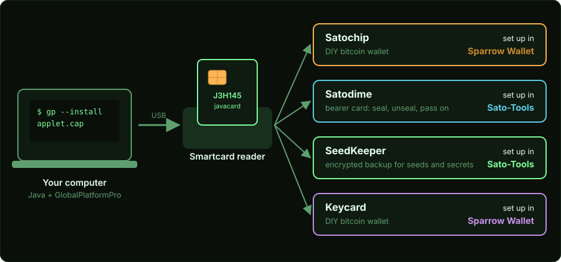

## 🧰 What you need

- 💳 A **J3H145** javacard. If you want to buy some, these are the ones
  used for this guide: [J3H145 on Alibaba](https://www.alibaba.com/x/B2cDpJ?ck=pdp)
- 🔌 A **USB smartcard reader**: a small box you plug into your computer
  and slide the card into, chip first. Don't use the **ACS ACR122U**, an
  NFC reader you tap the card on: the
  [Satochip-DIY guide](https://github.com/3rdIteration/Satochip-DIY#smartcard-readers)
  warns it is unreliable for installing applets and can break the card.
  It's fine for using the card once the applet is installed.
- 💻 A **Mac**, **Linux** (Debian, Ubuntu or Raspberry Pi OS) or **Windows**
  computer
- 🌐 An internet connection for the downloads

## 🛠️ Step 1: set up your computer (once)

This installs **Java** and **GlobalPlatformPro**, the `gp` command that
puts applets onto the card.

<details>
<summary><b>🍎 I'm on a Mac</b></summary>

1. Open the **Terminal**: press **Cmd + Space**, type `Terminal`, press
   **Enter**.

2. Install **Homebrew**, the Mac app installer for the Terminal. Skip
   this if you already have it (`brew --version` prints a version).

   ```bash
   /bin/bash -c "$(curl -fsSL https://raw.githubusercontent.com/Homebrew/install/HEAD/install.sh)"
   ```

   🔒 It asks for your Mac's password. Nothing shows while you type;
   that's normal, just type it and press **Enter**.

   ⚠️ When it finishes, it prints **Next steps** with two or three
   commands. Copy and run those too, or the Mac won't find `brew`.

3. Install Java:

   ```bash
   brew install --cask temurin
   ```

4. Install GlobalPlatformPro:

   ```bash
   brew install martinpaljak/brew/gppro
   ```

</details>

<details>
<summary><b>🐧 I'm on Linux</b></summary>

1. Open the **Terminal**: press **Ctrl + Alt + T**, or find **Terminal**
   in your apps.

2. Install Java, git and the smartcard service (`pcscd`):

   ```bash
   sudo apt update
   ```

   🔒 It asks for your computer's password. Nothing shows while you type;
   that's normal, just type it and press **Enter**.

   ```bash
   sudo apt install default-jre pcscd git
   ```

3. Download the [Satochip-DIY](https://github.com/3rdIteration/Satochip-DIY)
   files, which include GlobalPlatformPro as `gp.jar`:

   ```bash
   git clone https://github.com/3rdIteration/Satochip-DIY.git ~/Satochip-DIY
   ```

4. Give it the short name `gp`, so every command in this guide works as
   written:

   ```bash
   echo "alias gp='java -jar ~/Satochip-DIY/gp.jar'" >> ~/.bashrc
   ```

5. **Close the Terminal and open a new one**, so it picks up the new name.

</details>

<details>
<summary><b>🪟 I'm on Windows</b></summary>

⚠️ It's untested on Windows.

1. Install Java: download **Temurin** from <https://adoptium.net> and
   install it with the default options.

2. Download
   [gp.exe](https://github.com/3rdIteration/Satochip-DIY/raw/main/gp.exe)
   from [Satochip-DIY](https://github.com/3rdIteration/Satochip-DIY) into
   your **Downloads** folder.

3. Open **Command Prompt**: press the **Windows** key, type `cmd`, press
   **Enter**. It doesn't need to run as administrator.

4. Move into your Downloads folder:

   ```bat
   cd %USERPROFILE%\Downloads
   ```

5. Wherever this guide says `gp`, type `gp.exe` instead, for example
   `gp.exe --info`. Wherever it says `cd ~/Downloads`, use the line from
   step 4.

</details>

✅ Check it worked:

```bash
gp --version
```

It works if it prints a few lines starting with `#` and no
`command not found`.

💡 Java prints a few lines starting with `WARNING:` every time `gp` runs.
They are normal and you can ignore them.

## 🔌 Step 2: check the reader sees the card

Plug in the reader, put the card in (chip first) and run:

```bash
gp --info
```

✅ If you see `CPLC` lines and `Global Platform card`, the reader and card
are talking:

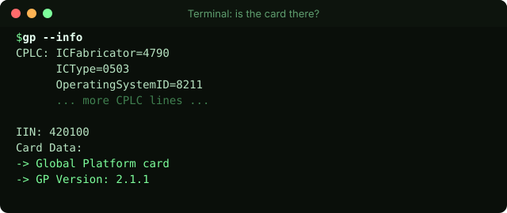

Now see what is already on the card:

```bash
gp --list
```

A blank card shows only what came on it from the factory: the card
manager (`ISD`) and one package (`A0000001515350`). Leave those alone.

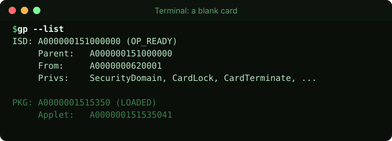

### 🛑 Stop if you see "Card cryptogram invalid"

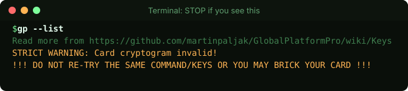

⚠️ This means the card was locked with keys you don't have. **Do not run
the command again**: after a few wrong tries the card locks itself for good.
Ask whoever sold you the card for its keys.

## 📥 Step 3: download the applet file

Download the file for the applet you want into your **Downloads** folder.
On each page, click the file name under **Assets** to download it.

| Applet | File to download | Set up with |
|---|---|---|
| Satochip | [SatoChip-v0.15-0.1.cap](https://github.com/Toporin/SatochipApplet/releases/tag/v0.15-0.1) | Sparrow Wallet |
| Satodime | [Satodime-0.1-0.2.cap](https://github.com/Toporin/Satodime-Applet/releases/tag/v0.1-0.2) | Sato-Tools |
| SeedKeeper | [SeedKeeper-v0.2-0.1.cap](https://github.com/Toporin/Seedkeeper-Applet/releases/tag/v0.2-0.1) | Sato-Tools |
| Keycard | [keycard_v3.2.cap](https://github.com/keycard-tech/status-keycard/releases/tag/3.2) | Sparrow Wallet |

<details>
<summary><b>💡 Why these versions and not the newest?</b></summary>

- **Satochip v0.15, not v0.16:** v0.16 (October 2026) changed how the card
  tweaks taproot keys, and Sparrow 2.5.5 still sends the old format, so a
  taproot wallet in Sparrow can't sign with a v0.16 card. Native SegWit
  works on both.
- **Satodime v0.1-0.2** is the latest stable release; the v0.2 builds are
  still marked beta.
- **Keycard 3.2, not 4.0:** Keycard 4.0 (September 2026) changed how the
  card and the computer set up their encrypted connection, and Sparrow
  2.5.5 still uses the old way.

Use the newer versions once Sparrow catches up.

</details>

<details>
<summary><b>🔍 Optional: check the file wasn't tampered with</b></summary>

Move into your Downloads folder:

```bash
cd ~/Downloads
```

🍎 Mac:

```bash
shasum -a 256 SatoChip-v0.15-0.1.cap
```

🐧 Linux:

```bash
sha256sum SatoChip-v0.15-0.1.cap
```

🪟 Windows:

```bat
certutil -hashfile SatoChip-v0.15-0.1.cap SHA256
```

The long code it prints must match the one on the release page:

- `SatoChip-v0.15-0.1.cap`:
  `83b117ebe047acdb1a171196c709016329ae0d221f9c4d0c606076a634ecdc2a`
- `keycard_v3.2.cap`:
  `9ed83c56e64cfb00d732cab4705e6f339fa1f039507ad86de7028bb3056675e8`

</details>

<a id="step-4"></a>

## ⚡ Step 4: put the applet on the card

🔄 Want to swap the applet on your card for another one? Remove the old
one first, then install the new one: see
[Switching to another applet](#switching) below.

Move into your Downloads folder, where the file is:

```bash
cd ~/Downloads
```

Then run **only the line for your applet**:

Satochip:

```bash
gp --install SatoChip-v0.15-0.1.cap
```

Satodime:

```bash
gp --install Satodime-0.1-0.2.cap
```

SeedKeeper:

```bash
gp --install SeedKeeper-v0.2-0.1.cap
```

Keycard (the extra settings make it the wallet Sparrow looks for):

```bash
gp --install keycard_v3.2.cap --applet A000000804000101 --create A00000080400010101
```

✅ It ends with a `loaded:` line:

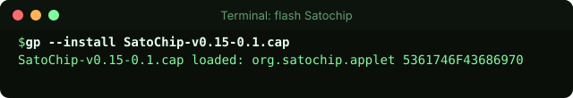

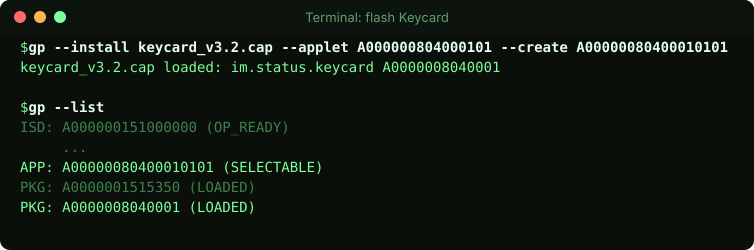

✅ Run `gp --list` again. A new line starting with `APP` and ending in
`SELECTABLE` means the applet is installed and ready:

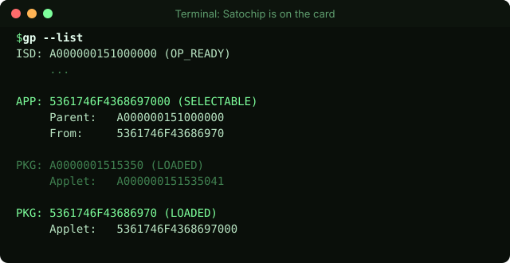

Now go to the setup step for your applet:

- Satochip: [Step 5a](#step-5a)
- SeedKeeper or Satodime: [Step 5b](#step-5b)
- Keycard: [Step 5c](#step-5c)

<a id="step-5a"></a>

## Step 5a: set up Satochip in Sparrow

👛 Get Sparrow Wallet for your computer from
<https://sparrowwallet.com/download/>.

You set the PIN and load the 12 seed words straight from Sparrow; the
Satochip app is not needed. Leave the card in the reader the whole time.

1. Create a new wallet in Sparrow and give it a name. Under **Keystores**,
   pick **Connected Hardware Wallet** and press **Scan...**

   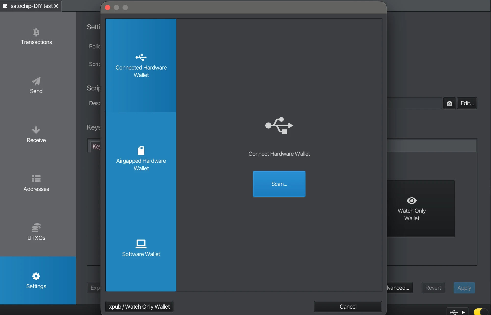

2. Sparrow finds the **Satochip**. Press **Import Keystore**.

   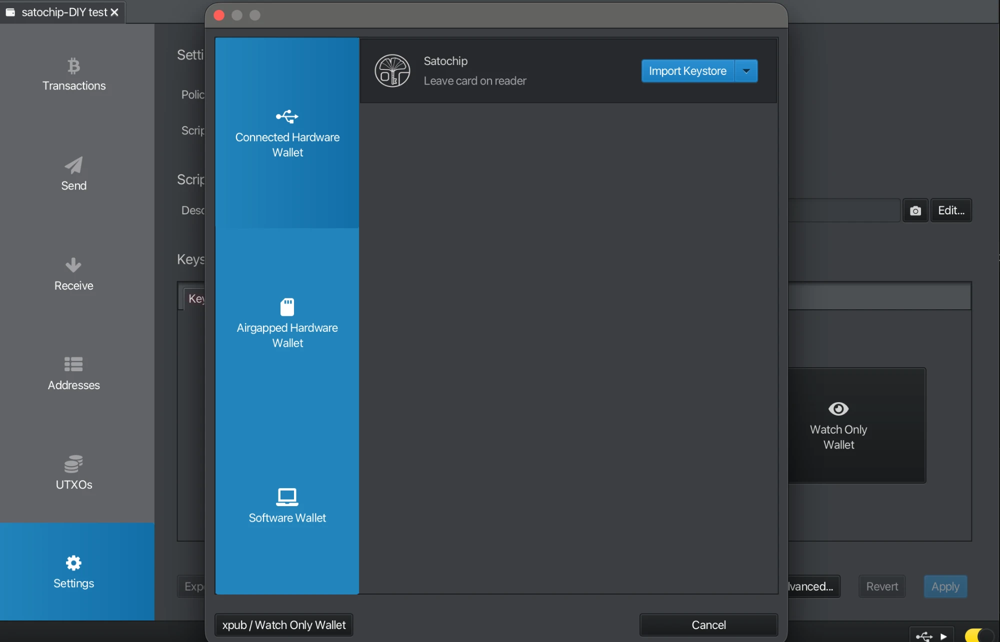

3. Sparrow asks you to **Choose a PIN code**. Type a PIN.

   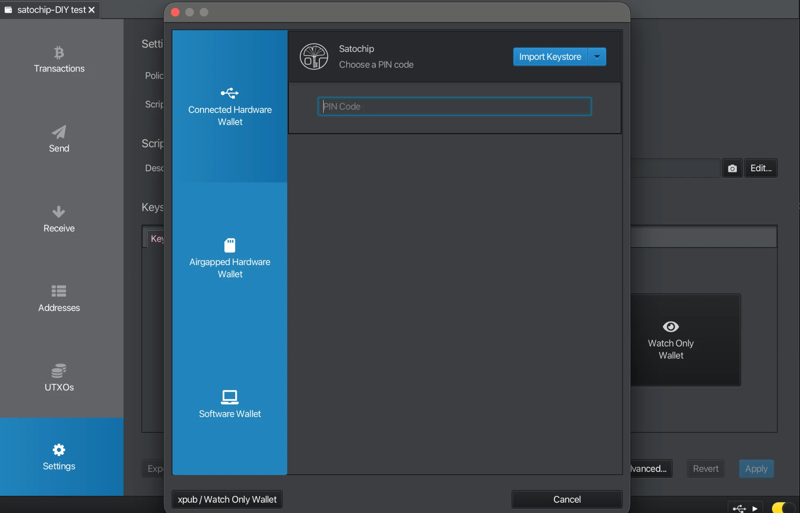

4. Sparrow says **Card not initialized**. Type the same PIN again in the
   box and press **Initialize**.

   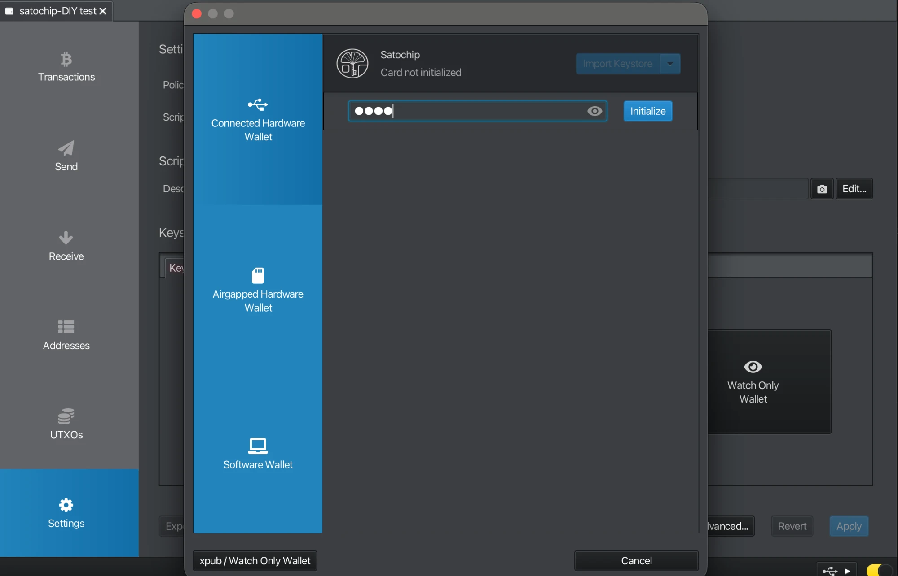

5. The **Satochip Seed Words** window opens. Press **Generate New** for a
   fresh set of 12 seed words, or type in 12 seed words you already have.
   ✍️ **Write the 12 seed words down on paper**, then press **OK**. Sparrow
   loads them onto the card, with no passphrase.

   💡 Sparrow makes these 12 seed words on your computer, so for real
   savings use a computer you trust.

   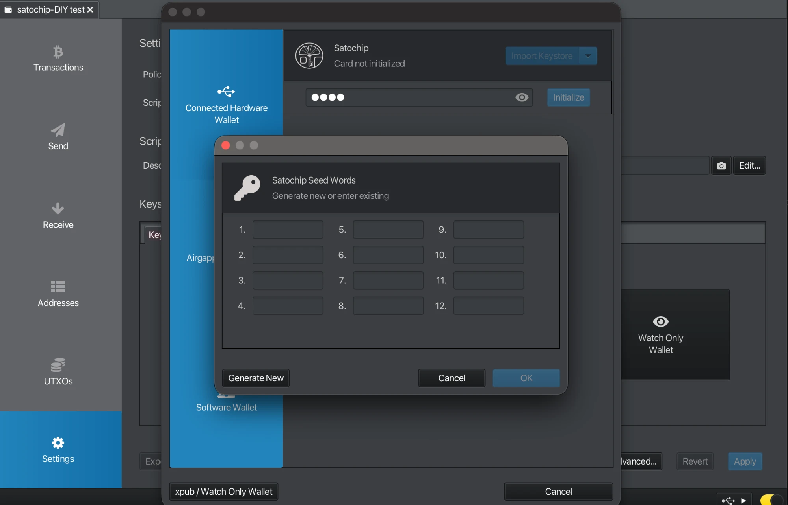

6. ✅ **Card Initialized**. Press **OK**.

   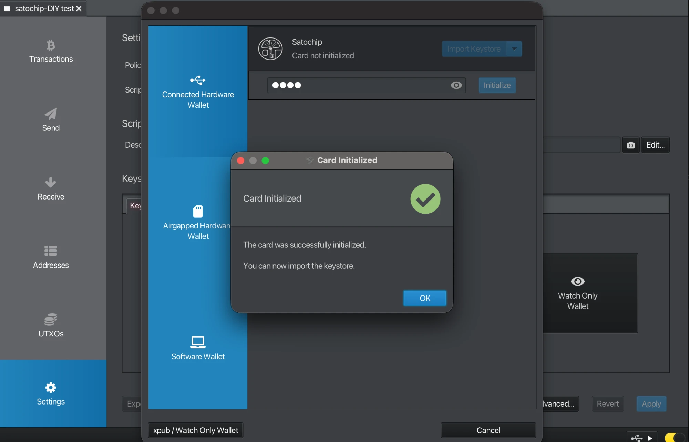

7. Back on the Satochip line, press **Import Keystore** again.

   

8. 🎉 The wallet now shows your Satochip, with its fingerprint: a short
   code that names your keys. Press **Apply** to save the wallet.

   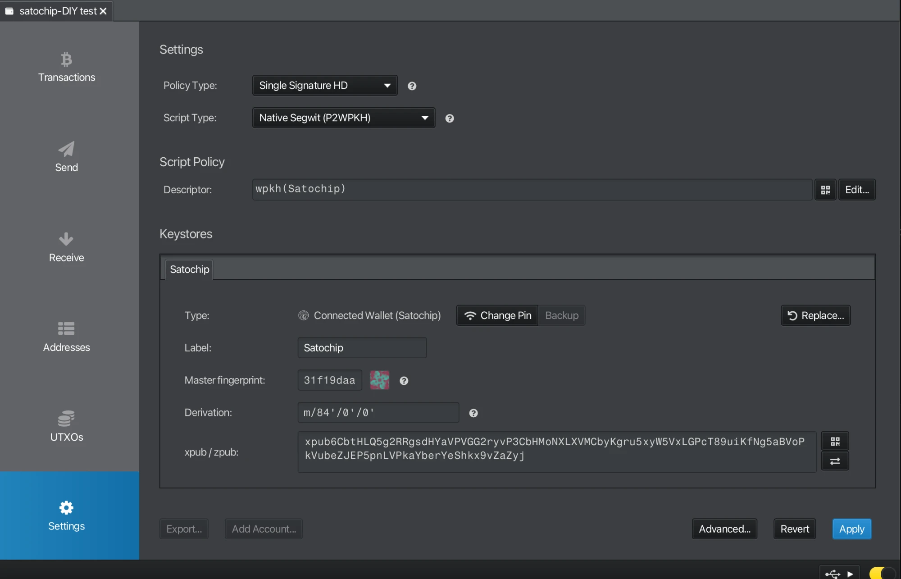

🔢 Sparrow gives the card **5 PIN attempts**. From the keystore you can also
**Change Pin** later.

<a id="step-5b"></a>

## Step 5b: set up SeedKeeper or Satodime in Sato-Tools

🧰 Get Sato-Tools for your computer from
<https://github.com/Toporin/Satochip-Utils/releases> (this guide used
0.4.0-beta).

Open Sato-Tools with the card in the reader and press **Let's go!**


💡 **If Sato-Tools doesn't see a card you just flashed, quit and reopen
the app.**

### SeedKeeper

1. Sato-Tools says **Your SeedKeeper is connected**. Press
   **Setup my card**.

   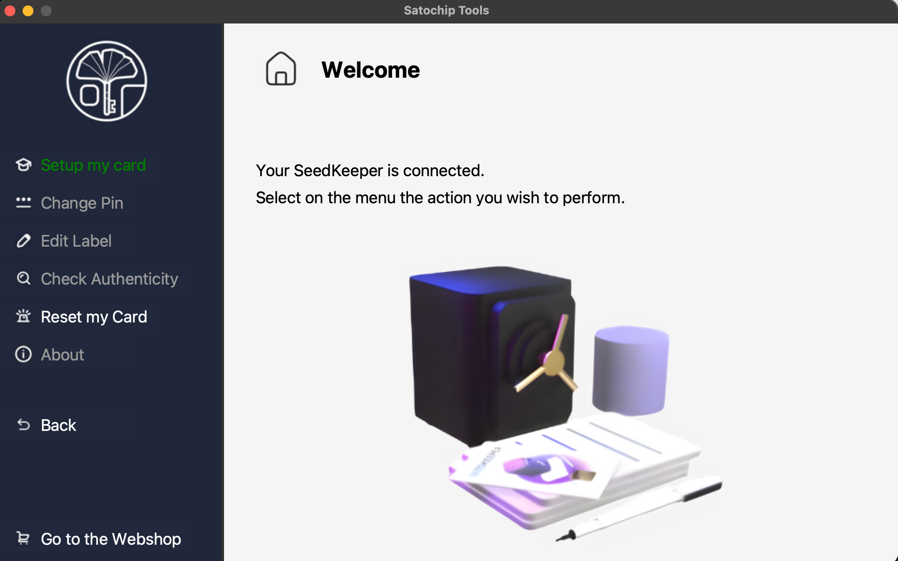

2. Type a PIN in **New PIN code** and again in **Confirm PIN code** (4 to
   16 characters), then press **Save PIN**.

   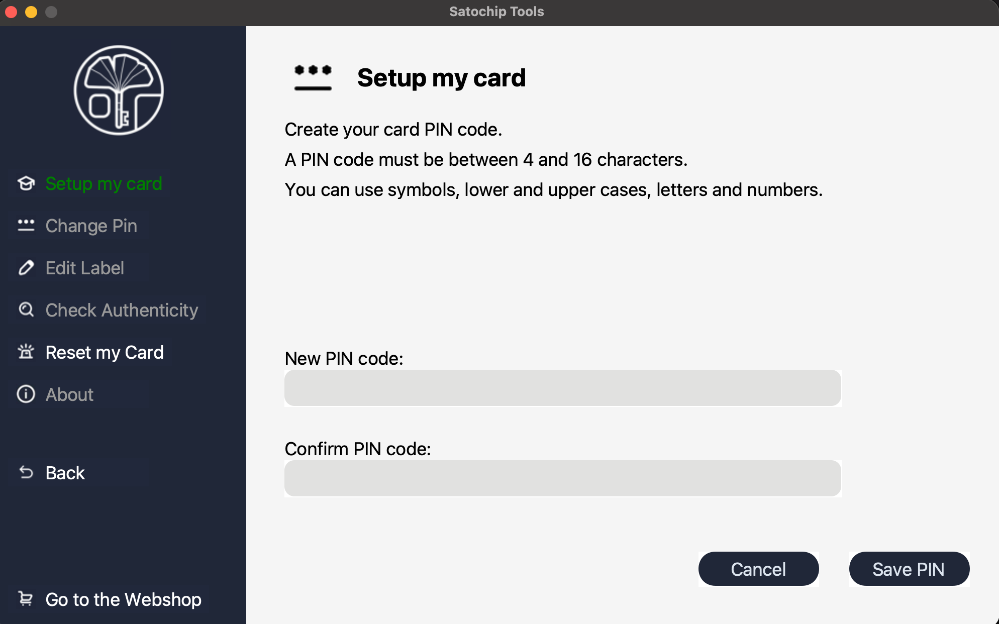

3. ✅ **Your card is now setup!** Press **Ok**.

   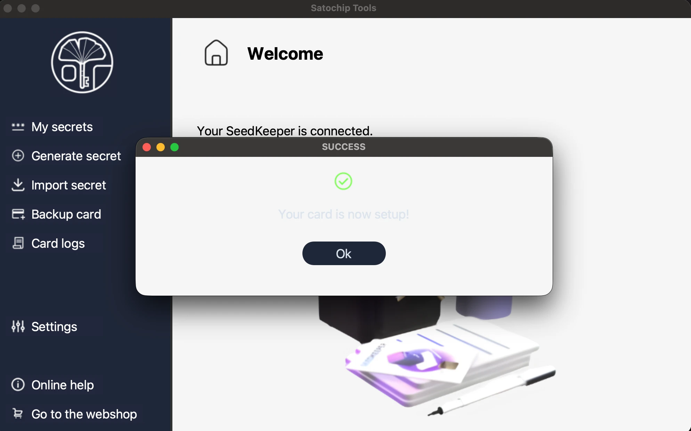

4. 🎉 The menu now has **My secrets**, **Generate secret**, **Import secret**,
   **Backup card** and **Card logs**. Your SeedKeeper is ready to store
   seed words, passphrases, passwords and wallet descriptors.

   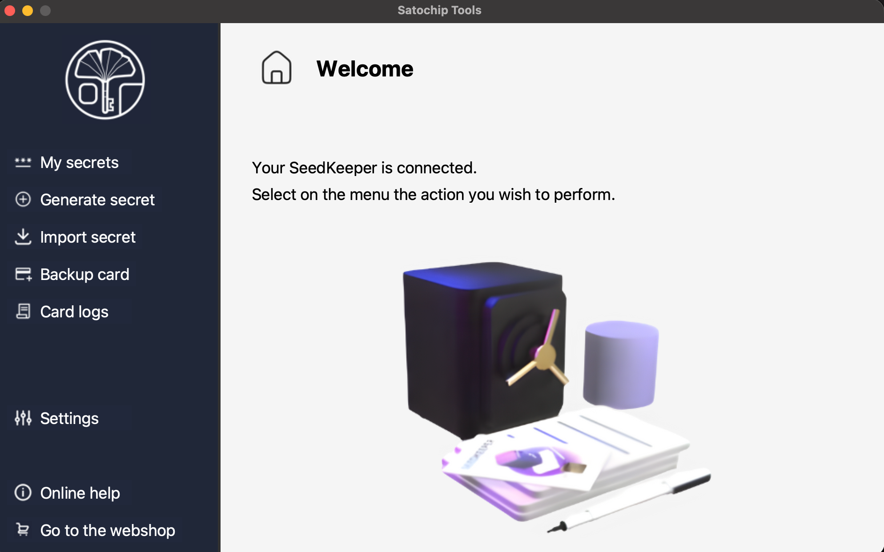

### Satodime

1. Sato-Tools says **Your Satodime is connected**, with three vaults:
   **Vault #0**, **Vault #1** and **Vault #2**.

   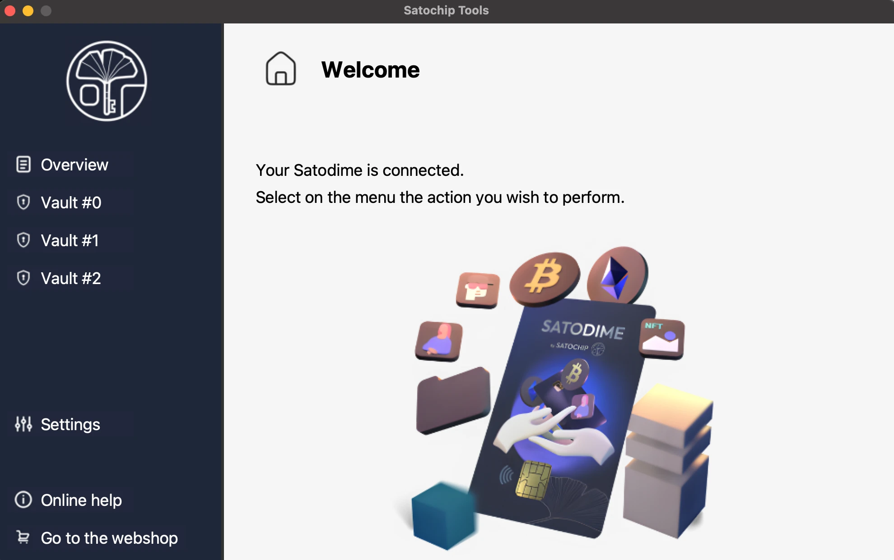

2. **Overview** shows all three vaults as **uninitialized**: nothing is
   sealed in them yet.

   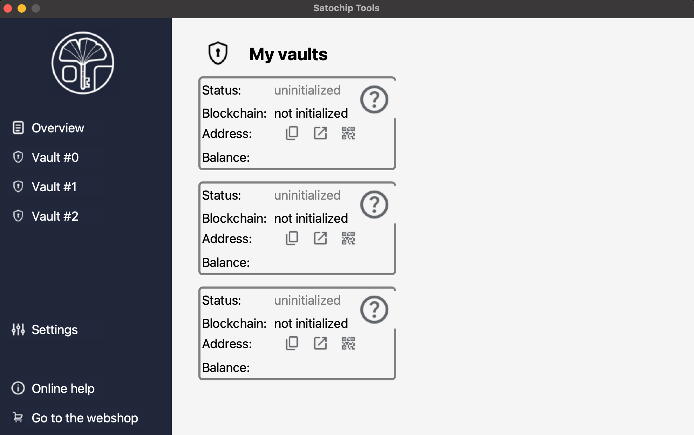

3. **About** shows the applet version and **Card has no owner**. **Take
   ownership** makes this computer the card's owner, which you need
   before sealing a vault.

   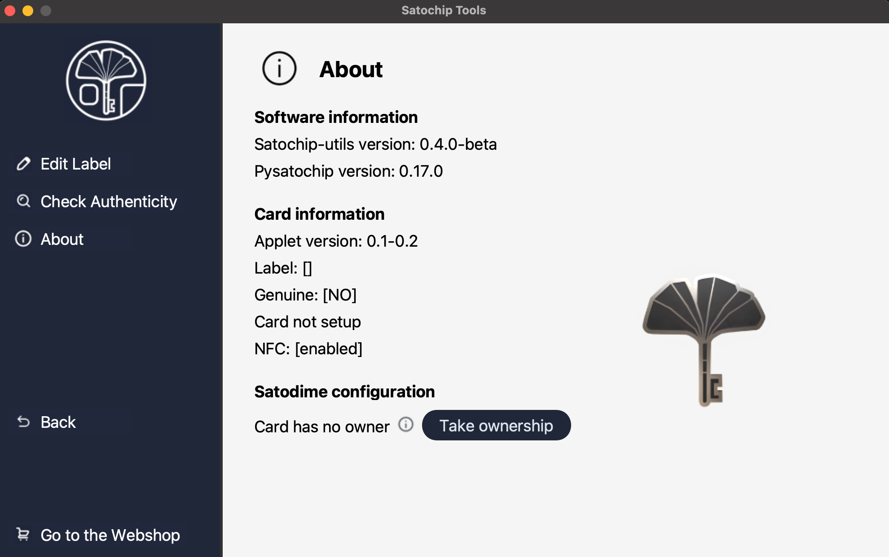

4. 🎉 Press **Take ownership**. About now says **You are the owner**, and the
   button changes to **Transfer ownership**, which you use when you hand
   the card to someone else.

💡 **Sealing** a vault makes a bitcoin address for it, with its private
key hidden inside the card. **Unsealing** shows the private key so the
bitcoin can be moved. Before you accept a Satodime as payment, check its
vaults are still sealed.

### 📱 On your phone

SeedKeeper and Satodime also have phone apps. Tap the card on the back of
a phone with NFC to use it there.

### ❓ Why does it say "Genuine: NO"?

Cards bought from Satochip come with a certificate from Satochip loaded at
the factory, and **Genuine** checks for it. A DIY card you flashed yourself
has no such certificate, so it always shows **Genuine: [NO]**. The applet
works exactly the same.

<a id="step-5c"></a>

## Step 5c: set up Keycard in Sparrow

👛 Get Sparrow Wallet for your computer from
<https://sparrowwallet.com/download/> if you haven't already.

Keycard is set up exactly like Satochip, with two differences: the PIN is
**exactly 6 digits**, and the card allows only **3 wrong PINs**.

1. Create a new wallet, pick **Connected Hardware Wallet**, press
   **Scan...** Sparrow finds the **Keycard**. Press **Import Keystore**.

   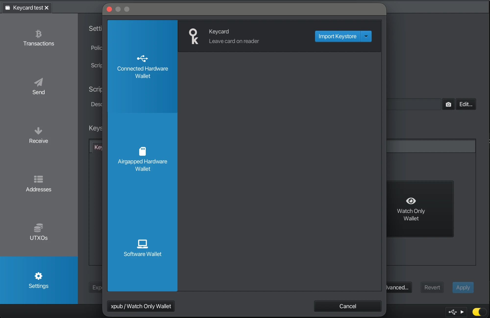

2. Choose a PIN of **exactly 6 digits**. Anything shorter or longer gets
   **PIN length must be between 6 and 6 characters**.

   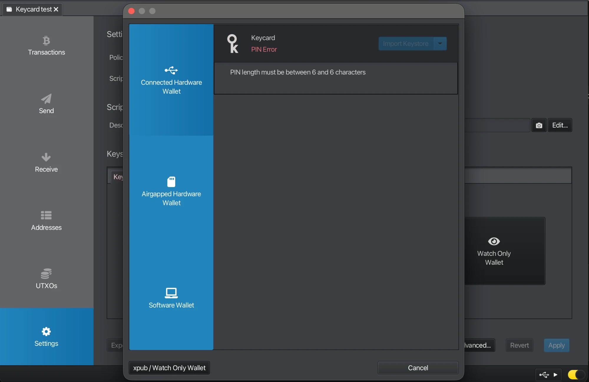

3. Type the same PIN again and press **Initialize**. The same seed words
   window as Satochip opens ([Step 5a](#step-5a), number 5): press **Generate New** or
   type your own, ✍️ **write the 12 seed words down**, then press **OK**.
   ✅ **Card Initialized**: press **OK**.

   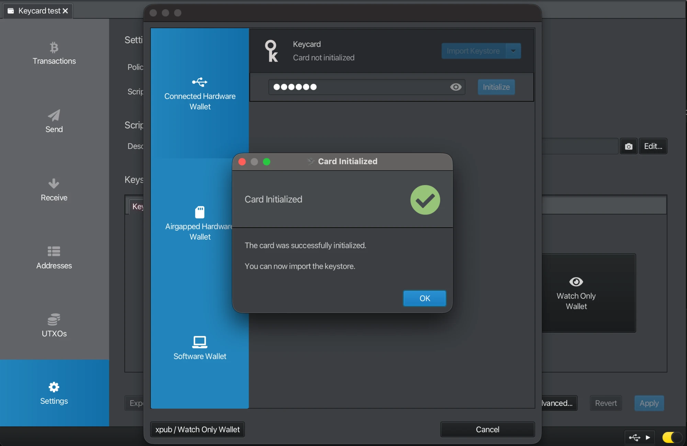

4. 🎉 Press **Import Keystore** again. The wallet now shows your Keycard,
   with its fingerprint. Press **Apply** to save the wallet.

   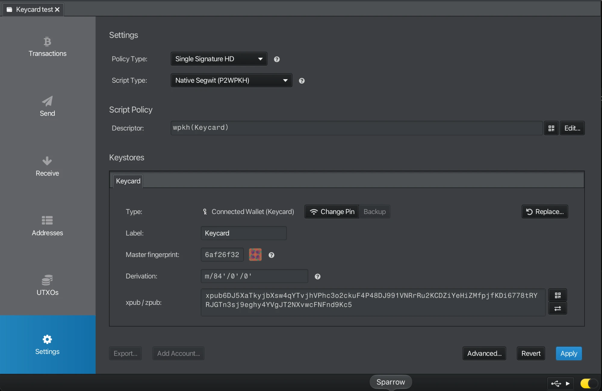

⚠️ **Your 12 seed words are the only way back.** After 3 wrong PINs the
Keycard locks, and Sparrow gives you no way to unlock it. If that happens,
remove Keycard, install it again and type your 12 seed words back in
Sparrow.

<a id="switching"></a>

## 🔄 Switching to another applet

⚠️ **Removing an applet erases everything stored in it**, including the
seed on a Satochip or Keycard and the secrets on a SeedKeeper. Only do this
when you have the 12 seed words written down or the wallet is a practice
one. The card itself is not harmed and can be flashed again as many times
as you like.

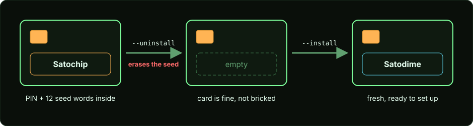

1. Move into your Downloads folder, where the applet files are:

   ```bash
   cd ~/Downloads
   ```

2. Not sure what's on the card? Run `gp --list`: the `APP` line shows it.

3. Remove the applet that's on the card now. Run **only the line for it**:

   Satochip:

   ```bash
   gp --uninstall SatoChip-v0.15-0.1.cap
   ```

   Satodime:

   ```bash
   gp --uninstall Satodime-0.1-0.2.cap
   ```

   SeedKeeper:

   ```bash
   gp --uninstall SeedKeeper-v0.2-0.1.cap
   ```

   Keycard:

   ```bash
   gp --delete A0000008040001 -f
   ```

4. ✅ Run `gp --list` again. Only the card manager (`ISD`) and the factory
   package (`A0000001515350`) should be left.

5. Install the new applet ([Step 4](#step-4)) and set it up
   ([Step 5a](#step-5a), [5b](#step-5b) or [5c](#step-5c)).

For example:

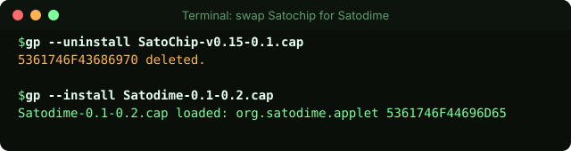

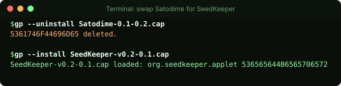

## 🩺 Troubleshooting

| You see | What to do |
|---|---|
| 🍎 `brew: command not found` | Run the **Next steps** commands Homebrew printed when it finished installing. |
| 🐧 `gp: command not found` | Close the Terminal and open a new one. |
| `No such file` or `does not exist` | Run `cd ~/Downloads` first, and check the file is in Downloads. |
| `Card cryptogram invalid` | The card is locked with other keys. Stop, don't retry. |
| `LOAD failed: 0x6438` | The applet was built for a newer Java Card than the card has. |
| `INSTALL ... failed: 0x6444` or `0x6F00` | The card is missing a feature the applet needs. |
| `gp --install` fails on a card that already has an applet | Run `gp --list`. If an `APP` line is there, remove that applet first (see [Switching to another applet](#switching)). |
| Sparrow's **Scan...** finds nothing | Quit Sato-Tools and any other card app, take the card out and put it back in, then press **Scan...** again. |
| Forgot the PIN, or the card is blocked after too many wrong PINs | Remove the applet and install it again (this erases the card), then restore your 12 seed words. |
| Sato-Tools doesn't see the card | Quit and reopen Sato-Tools. |
| `gp` finds no reader, or says no card is in | Put the card in chip first. If it still says no card, the reader got stuck: unplug it from the computer, plug it back in with the card inside, and try again. 🐧 Then run `sudo systemctl restart pcscd`. |

## 🚀 Going further

- 🎥 [Video: flashing 7 different applets onto these cards](https://www.youtube.com/watch?v=j13XrvPFZk0)
- 🔒 Lock the card with your own key, so nobody else can change what's
  installed on it:
  [Satochip-DIY: Locking Javacards](https://github.com/3rdIteration/Satochip-DIY#locking-javacards-optional)
- 🏗️ Build the applets yourself. The files above were built by someone
  else, so you trust that they match the public source code. Building
  from the source code yourself means what goes on your card is exactly
  the code anyone can read:
  [Satochip-DIY: Building](https://github.com/3rdIteration/Satochip-DIY#harder-but-better-method---building-on-your-own-pc)

## 🙏 Credits

- 🙌 [Toporin](https://github.com/Toporin), creator of
  [Satochip](https://satochip.io), for the Satochip, Satodime and
  SeedKeeper applets and Sato-Tools.
- 🛠️ [Satochip-DIY](https://github.com/3rdIteration/Satochip-DIY) by
  3rdIteration, the DIY guide this one follows, with its tested card
  and reader lists and `gp.jar`.
- [Keycard](https://github.com/keycard-tech/status-keycard) for the
  Keycard applet.
- 💳 [GlobalPlatformPro](https://github.com/martinpaljak/GlobalPlatformPro)
  by Martin Paljak for loading applets onto the card.
