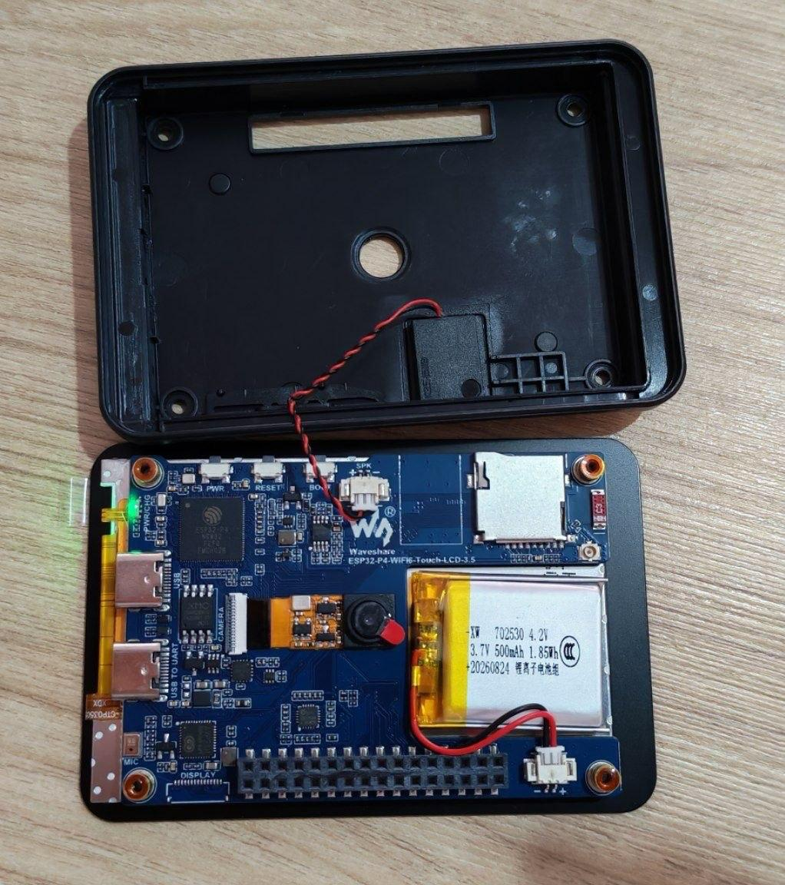

# 📟 DIY 署名デバイス：SeedSigner、Kern、KISS Signer

署名デバイスは、ビットコインの鍵を保管して取引に署名する、オフラインの小さな機器です。そのため、鍵がパソコンやスマートフォンに触れることはありません。このガイドでは、オープンソースの署名デバイスを
[Waveshare ESP32-P4-WIFI6-Touch-LCD-3.5](https://www.waveshare.com/esp32-p4-wifi6-touch-lcd-3.5.htm)
にインストール（「書き込み」）します。カメラと microSD スロットが付いた3.5インチのタッチスクリーンのボードです。はんだ付けは不要です。

| 署名デバイス | 書き込み方法 | 状態 |
|---|---|---|
| [Kern](https://github.com/odudex/Kern) | Web ブラウザで | テスト版 |
| [KISS Signer](https://github.com/DIYbitcoin/kiss-signer) | Web ブラウザで | ベータ版 |
| [SeedSigner](https://github.com/kdmukai/seedsigner-micropython-builder) | ターミナルで | テスト版 |

📷 **使い方：** 署名デバイスはインターネットに一切つながりません。カメラで QR コードを読み取って Sparrow などのウォレットアプリと連携し、取引の署名も同じ方法で行います。

⚠️ **3つとも、このボードではまだ初期のバージョンです。練習用のシードワードと testnet（価値のない練習用のビットコイン）か、ごく少額だけを使い、本当の貯蓄には絶対に使わないでください。**

## 🔌 ステップ1：ボードをつなぐ

**UART** と書かれたポートに USB-C ケーブルを差し込みます。

💡 データ通信ができるとわかっているケーブルを使ってください。充電専用のケーブルでもボードに電源は入りますが、パソコンはボードをまったく認識しません。

<a id="step-2"></a>

## 💻 ステップ2：パソコンの準備

🌐 **Kern** と **KISS Signer** は **Chrome** か **Brave** の Web 書き込みツールで書き込むので、必要なのはそのブラウザだけです（Linux では、下の Linux の欄の手順2も行ってください）。

💻 **SeedSigner** はターミナルから `esptool` で書き込みます：下でインストールします。

<details>
<summary><b>🍎 Mac の場合</b></summary>

1. **ターミナル** を開きます：**Cmd + Space** を押し、`Terminal` と入力して **Enter** を押します。

2. ターミナルで使う Mac 用のアプリのインストーラー、**Homebrew** をインストールします。すでに入っている場合は、この手順を飛ばします（`brew --version` でバージョンが表示されます）。

   ```bash
   /bin/bash -c "$(curl -fsSL https://raw.githubusercontent.com/Homebrew/install/HEAD/install.sh)"
   ```

   🔒 Mac のパスワードを聞かれます。入力中は何も表示されませんが、それで正常です。そのまま入力して **Enter** を押します。

   ⚠️ 終わると、**Next steps** として2つか3つのコマンドが表示されます。それもコピーして実行してください。実行しないと Mac が `brew` を見つけられません。

3. esptool をインストールします。

   ```bash
   brew install esptool
   ```

</details>

<details>
<summary><b>🐧 Linux の場合</b></summary>

1. **ターミナル** を開きます：**Ctrl + Alt + T** を押すか、アプリの中から **ターミナル** を探します。

2. 自分のユーザーアカウントがボードと通信できるようにします（ブラウザで使う Kern も含め、3つの署名デバイスすべてで必要です）。

   ```bash
   sudo usermod -aG dialout $USER
   ```

   🔒 パソコンのパスワードを聞かれます。入力中は何も表示されませんが、それで正常です。そのまま入力して **Enter** を押します。

3. 変更を反映させるために、**パソコンからログアウトして、もう一度ログインします**。

4. SeedSigner 用に `esptool` と `unzip` をインストールします。もう一度ターミナルを開いて、次を実行します。

   ```bash
   sudo apt update
   ```

   ```bash
   sudo apt install pipx unzip
   ```

   ```bash
   pipx install esptool
   ```

   ```bash
   pipx ensurepath
   ```

5. `esptool` が見つかるように、**ターミナルを閉じて新しく開きます**。

</details>

✅ SeedSigner 用に、esptool が動くか確認します。

```bash
esptool version
```

表示されるバージョンが **5.3 以降** である必要があります。

<a id="step-3"></a>

## 🧬 ステップ3：自分のチップを知る

3.5インチのボードには、ESP32-P4 チップの2つのバージョンのどちらかが載っています：古いボードは **v1.x**、新しいボードは **v3.x** なので、最近買ったボードはおそらく v3.x です。どの署名デバイスも、自分のチップ用に作られたビルドが必要です：v1.x のビルドは v3.x のチップでは起動せず、その逆も同じです。

| 署名デバイス | v1.x チップ | v3.x チップ |
|---|---|---|
| Kern | Web 書き込みツール、または公式リリース | Web 書き込みツールのみ（テスト版） |
| KISS Signer | インストールページ（署名付きベータ版） | テスト用インストーラー（テスト版） |
| SeedSigner | タッチ修正ビルド | ビルダーのテストビルド |

🌐 **Kern** と **KISS Signer:** 確認は不要です。下のそれぞれの項目で方法を説明しています。

💻 **SeedSigner:** 正しいビルドをダウンロードできるように、ここで `esptool`（[ステップ2](#step-2)）を使って確認します。

1. ボードがどこにあるかをターミナルに教えます。これで `$PORT` として保存されます。

   🍎 Mac:

   ```bash
   PORT=$(ls /dev/cu.usbmodem* | head -n 1)
   ```

   🐧 Linux:

   ```bash
   PORT=$(ls /dev/ttyACM* | head -n 1)
   ```

2. チップを確認します。

   ```bash
   esptool -p $PORT chip-id
   ```

   ✅ `ESP32-P4 (revision v1.3)` のように表示されたら、**v1.x** のチップです。`v3.0` 以上なら **v3.x** のチップです。

## Kern

1. **Chrome** か **Brave** で [Kern の Web 書き込みツール](https://odudex.github.io/Kern/flash/) を開きます（Safari と Firefox では書き込めません）。
2. ボードをつなぎ、**Latest CI Build** を書き込みます。書き込みツールがチップを読み取り、v1.x か v3.x のビルドを自動で選びます。
3. ✅ ケーブルを抜き、3秒待ってから差し直します。

📦 公式の [Kern のリリース](https://github.com/odudex/Kern/releases) は **v1.x** のチップにしか対応していません。

## KISS Signer

1. **Chrome** か **Brave** で [インストールページ](https://diybitcoin.github.io/kiss-signer/) を開き、ボードをつないで書き込みます。
2. ✅ ケーブルを抜き、3秒待ってから差し直します。
3. 画面が黒いままですか？そのボードには新しい v3.x のチップが載っています：代わりに[テスト用インストーラー](https://diybitcoin.github.io/kiss-signer/test/)からもう一度書き込みます。

⚠️ テスト用インストーラーにあるのは署名されていないテスト版で、実際の v3.x ボードではまだ試していません。

## SeedSigner

このボード用の SeedSigner は初期のバージョンで、ターミナルから `esptool`（[ステップ2](#step-2)）で書き込みます。

### 1️⃣ 自分のチップ用のビルドをダウンロード

**ダウンロード** フォルダに保存します。

- **v1.x**:
  [seedsigner-waveshare-p4-35-pre-rev3-touchfix.zip](https://github.com/DIYbitcoin/guides/releases/download/seedsigner-p4-35-touchfix/seedsigner-waveshare-p4-35-pre-rev3-touchfix.zip)
- **v3.x**: `flashable-dist-waveshare-esp32-p4-35` を、ビルダーの [Actions のビルド](https://github.com/kdmukai/seedsigner-micropython-builder/actions)から入手します（GitHub へのログインが必要です）

<details>
<summary><b>👆 v1.x のビルドについて</b></summary>

スワイプでボタンが押されてしまうのではなく、メニューがスクロールするようにする **タッチ修正** が入っています。この修正はまだ[オープン中のプルリクエスト](https://github.com/kdmukai/esp-board-common/pull/21)で、SeedSigner の一部にはなっていません。v1.3 のボードで試しました。

zip の SHA256：
`d372f345a1895f2e90ed5d86cf473136bd69948ec2384de7c8dd9313eea169e5`

</details>

<a id="seedsigner-unzip"></a>

### 2️⃣ 展開する

ダウンロードフォルダに移動します。

```bash
cd ~/Downloads
```

次に、**自分の** ビルド用の2行を実行します。

**v1.x:**

```bash
unzip seedsigner-waveshare-p4-35-pre-rev3-touchfix.zip
```

```bash
cd seedsigner-waveshare-p4-35-pre-rev3-touchfix
```

**v3.x:**

```bash
unzip flashable-dist-waveshare-esp32-p4-35.zip -d seedsigner-v3
```

```bash
cd seedsigner-v3
```

### 3️⃣ 書き込む

💡 [ステップ3](#step-3) のあとで新しいターミナルを開いた場合は、先にそのステップの `PORT=` の行をもう一度実行します。

```bash
esptool --chip esp32p4 -p $PORT write-flash @flash_args
```

✅ 終わると、ボードが再起動して SeedSigner が立ち上がります。🎉

<a id="battery"></a>

## 🔋 バッテリーを取り付ける

ボードには小さなバッテリーと小さなドライバーが付いているので、ケーブルなしでも動かせます。

1. ケースの裏にある4つの小さなカバーを、爪で外します。その下にネジがあります。
2. ドライバーで4本のネジを外し、ケースの裏ぶたを持ち上げて外します。
3. バッテリーのプラグを、ボードの右下にあるバッテリー用のソケットに差し込みます。向きは1つしか合わないので、入らなければ裏返してください。無理に押し込まないでください。
4. ✅ 電源ボタンの横の緑のランプが点くはずです。
5. ケースの裏ぶたを戻し、ネジで閉めます。バッテリーを入れたままでも、ケースは普通に閉まります。



## 🩺 困ったときは

| 表示されたもの | 対処法 |
|---|---|
| ブラウザの書き込みツールに選べるボードが出ない | **Chrome** か **Brave** を使い、**UART** のポートとデータ通信用のケーブルを使います。🐧 Linux では [ステップ2](#step-2) を行います。 |
| `port is busy` または `could not open port` | ブラウザの書き込みツールのタブと、ボードを使っているほかのターミナルを閉じて、もう一度試します。 |
| パソコンがボードを認識しない、または 🍎 `no matches found: /dev/cu.usbmodem*` / 🐧 `No such file or directory` が `PORT=` の行のあとに出る | **UART** のポートと、データ通信ができるとわかっているケーブルを使います。 |
| 🐧 `Permission denied`、またはブラウザがボードを開けない | Linux で [ステップ2](#step-2) を、ログアウトしてもう一度ログインするところまで行います。 |
| 🍎 `brew: command not found` | Homebrew がインストールの最後に表示した **Next steps** のコマンドを実行します。 |
| 🐧 `esptool: command not found` | ターミナルを閉じて、新しく開きます。 |
| `flash_args` が見つからない | 展開したフォルダに移動していません：[SeedSigner の手順2](#seedsigner-unzip) をやり直します。 |
| 書き込んだあと画面に何も出ない | ケーブルを抜き、3秒待ってから差し直します。ビルドが自分のチップに合っているか確認します。 |
| `esptool` でチップに書き込めない | 5.3 以降が必要です：🍎 `brew upgrade esptool`、🐧 `pipx upgrade esptool`。 |

## 🙏 謝辞

- odudex の [Kern](https://github.com/odudex/Kern)。
- kdmukai の [SeedSigner](https://github.com/kdmukai/seedsigner-micropython-builder)。
- DIYbitcoin の [KISS Signer](https://github.com/DIYbitcoin/kiss-signer)。
