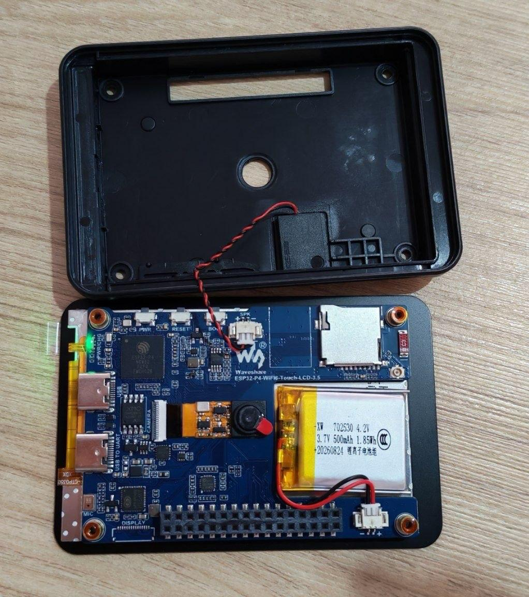

# 📟 DIY signers: SeedSigner, Kern and KISS Signer

A signer is a small offline device that holds your bitcoin keys and signs
transactions, so your keys never touch a computer or phone. This guide
installs ("flashes") an open source signer onto the
[Waveshare ESP32-P4-WIFI6-Touch-LCD-3.5](https://www.waveshare.com/esp32-p4-wifi6-touch-lcd-3.5.htm),
a 3.5 inch touchscreen board with a camera and a microSD slot. No soldering.

📷 **How you use it:** the signer never connects to the internet. You
pair it with a wallet app like Sparrow by scanning QR codes with its
camera, and sign transactions the same way.

⚠️ **All three are early versions on this board. Use practice seed words
and testnet (practice bitcoin with no value) or tiny amounts only, never
your real savings.**

### 🧰 What you need

- 📟 The Waveshare 3.5 inch board
- 🔌 A USB-C cable that carries data. A charge only cable powers the
  board, but the computer sees nothing at all.
- 💻 A computer: a Mac or Linux for SeedSigner; any computer with
  **Chrome** or **Brave** for Kern and KISS Signer

### 👉 Pick your signer

Each one is a complete path, from plugging in to the signer's first
screen. Follow only the one you pick.

- 🌐 **[Kern](#kern):** the easiest. Flash it in Chrome or Brave in a few
  clicks.
- 🌐 **[KISS Signer](#kiss):** also flashed in Chrome or Brave.
- 💻 **[SeedSigner](#seedsigner):** flashed by typing a few commands in
  the Terminal. Four short pages.

<a id="kern"></a>

## 🌐 Kern

You need **Chrome** or **Brave**. Safari and Firefox can't flash.

1. Plug the USB-C cable into the port on the board marked **UART**, and
   the other end into your computer.

   🐧 **On Linux**, do the [Linux step](#linux-kern) below first.

2. Open the [Kern web flasher](https://odudex.github.io/Kern/flash/).
3. Leave **📦 Latest CI Build** selected.
4. Under **Board**, pick **Waveshare ESP32-P4 3.5" (320×480 SPI)**. The
   list starts on a different board, so check this one.
5. Click **🔌 Connect**. A small window opens: pick your board in it
   (🍎 its name has `usbmodem` in it, 🐧 `ttyACM`), then click
   **Connect**.

   ✅ The black box under the buttons prints `Connected to: ESP32-P4`.
   The flasher reads your chip and picks the v1.x or v3.x build itself.

6. Click **⚡ Flash** and wait, without unplugging.

   ✅ It prints `Device reset. Flash successful! ✓`.

7. Unplug the board, wait 3 seconds, plug it back in.

   ✅ Kern starts on the board. 🎉

<details id="linux-kern">
<summary><b>🐧 Linux step: let the browser talk to the board</b></summary>

1. Open the **Terminal**: press **Ctrl + Alt + T**.
2. Run:

   ```bash
   sudo usermod -aG dialout $USER
   ```

   🔒 It asks for your computer's password. Nothing shows while you type;
   that's normal, just type it and press **Enter**.

3. **Log out of your computer and log back in**, then go back to step 2
   above.

</details>

📦 The official [Kern releases](https://github.com/odudex/Kern/releases)
only cover **v1.x** chips, so use the web flasher.

Next: [🔋 install the battery](#battery), or
[🩺 troubleshooting](#troubleshooting) if something went wrong.

<a id="kiss"></a>

## 🌐 KISS Signer

You need **Chrome** or **Brave**. Safari and Firefox can't flash.

1. Plug the USB-C cable into the port on the board marked **UART**, and
   the other end into your computer.

   🐧 **On Linux**, do the [Linux step](#linux-kiss) below first.

2. Open the [KISS Signer install page](https://diybitcoin.github.io/kiss-signer/).
3. Under **Which board is it?**, pick **Waveshare 3.5in**.
4. Tick the box **This erases the device. I'm starting with keys that
   hold nothing.**
5. Click **Connect and install**. A small window opens: pick your board in
   it (🍎 its name has `usbmodem` in it, 🐧 `ttyACM`), then click
   **Connect**.
6. In the next window, click **Install KISS Signer (Waveshare 3.5in)**.
   Tick **Erase device**, click **Next**, then click **Install**. Wait,
   without unplugging.

   ✅ It says **Installation complete!**

7. Unplug the board, wait 3 seconds, plug it back in.

   ✅ The board starts on **FRUIT ISLAND**, the game KISS Signer shows
   first. 🎉

8. Screen stays black? Your board has the newer **v3.x** chip, and this
   release is for v1.x. Flash it again from the
   [test installer](https://diybitcoin.github.io/kiss-signer/test/): pick
   your board under **1. Your board**, then click **Connect and install**.
   It reads your chip and picks the build that fits.

   ⚠️ The test installer has unsigned test versions, not yet tried on a
   real v3.x board.

<details id="linux-kiss">
<summary><b>🐧 Linux step: let the browser talk to the board</b></summary>

1. Open the **Terminal**: press **Ctrl + Alt + T**.
2. Run:

   ```bash
   sudo usermod -aG dialout $USER
   ```

   🔒 It asks for your computer's password. Nothing shows while you type;
   that's normal, just type it and press **Enter**.

3. **Log out of your computer and log back in**, then go back to step 2
   above.

</details>

Next: [🔋 install the battery](#battery), or
[🩺 troubleshooting](#troubleshooting) if something went wrong.

<a id="seedsigner"></a>

## 💻 SeedSigner 1: get your computer ready

SeedSigner for this board is an early version by Keith (kdmukai). You
flash it by typing commands in the **Terminal** with `esptool`, a tool
from the chip's maker. Each command below has a **copy** button: copy it,
paste it into the Terminal, press **Enter**.

<details>
<summary><b>🍎 I'm on a Mac</b></summary>

1. Open the **Terminal**: press **Cmd + Space**, type `Terminal`, press
   **Enter**.

2. Install **Homebrew**, the Mac app installer for the Terminal. Skip
   this if you already have it (`brew --version` prints a version).

   ```bash
   /bin/bash -c "$(curl -fsSL https://raw.githubusercontent.com/Homebrew/install/HEAD/install.sh)"
   ```

   🔒 It asks for your Mac's password. Nothing shows while you type;
   that's normal, just type it and press **Enter**.

   ⚠️ When it finishes, it prints **Next steps** with two or three
   commands. Copy and run those too, or the Mac won't find `brew`.

3. Install esptool:

   ```bash
   brew install esptool
   ```

</details>

<details>
<summary><b>🐧 I'm on Linux</b></summary>

1. Open the **Terminal**: press **Ctrl + Alt + T**.

2. Let your user talk to the board:

   ```bash
   sudo usermod -aG dialout $USER
   ```

   🔒 It asks for your computer's password. Nothing shows while you type;
   that's normal, just type it and press **Enter**.

3. Install `esptool` and `unzip`, one line at a time:

   ```bash
   sudo apt update
   ```

   ```bash
   sudo apt install pipx unzip
   ```

   ```bash
   pipx install esptool
   ```

   ```bash
   pipx ensurepath
   ```

4. **Log out of your computer and log back in**, then open the Terminal
   again.

</details>

✅ Check esptool works:

```bash
esptool version
```

It must print **5.3 or newer**. An older one can't flash the newer chips:
🍎 `brew upgrade esptool`, 🐧 `pipx upgrade esptool`.

Next: [SeedSigner 2: plug in and check your chip](#ss-chip).

<a id="ss-chip"></a>

## 💻 SeedSigner 2: plug in and check your chip

The board ships with one of two versions of its chip, **v1.x** on older
boards or **v3.x** on newer ones, and each needs its own SeedSigner
build. This page tells you which one you have.

1. Plug the USB-C cable into the port on the board marked **UART**, and
   the other end into your computer.

2. Run the line for your computer:

   🍎 Mac:

   ```bash
   esptool -p $(ls /dev/cu.usbmodem* | head -n 1) chip-id
   ```

   🐧 Linux:

   ```bash
   esptool -p $(ls /dev/ttyACM* | head -n 1) chip-id
   ```

3. Find the line that says `ESP32-P4 (revision ...)`:

   - `revision v1.3` or any **v1**: you have a **v1.x** chip.
   - `revision v3.0`, `v3.2` or any **v3**: you have a **v3.x** chip.

   Write it down: the next page asks for it.

Next: [SeedSigner 3: download the build for your chip](#ss-download).

<a id="ss-download"></a>

## 💻 SeedSigner 3: download the build for your chip

Use **only the build for your chip** from SeedSigner 2. The other one
won't start.

<details open>
<summary><b>1️⃣ My chip is v1.x</b></summary>

Click to download
[seedsigner-waveshare-p4-35-pre-rev3-touchfix.zip](https://github.com/DIYbitcoin/guides/releases/download/seedsigner-p4-35-touchfix/seedsigner-waveshare-p4-35-pre-rev3-touchfix.zip)
into your **Downloads** folder.

It includes a **touch fix** so swipes scroll through menus instead of
pressing a button. The fix is still an
[open pull request](https://github.com/kdmukai/esp-board-common/pull/21),
not yet part of SeedSigner. Tested on a v1.3 board.

SHA256 of the zip:
`d372f345a1895f2e90ed5d86cf473136bd69948ec2384de7c8dd9313eea169e5`

</details>

<details open>
<summary><b>3️⃣ My chip is v3.x</b></summary>

Keith's builds come from GitHub, and you need a free GitHub account to
download them.

1. Sign in at [github.com/login](https://github.com/login), or make an
   account there first.
2. Open
   [SeedSigner's latest builds](https://github.com/kdmukai/seedsigner-micropython-builder/actions/workflows/build-firmware.yml?query=branch%3Amain+is%3Asuccess).
3. Click the **top** build in the list, which is the newest.
4. Scroll down to **Artifacts** and click
   **flashable-dist-waveshare-esp32-p4-35** to download it into your
   **Downloads** folder.

   ⚠️ Make sure the name ends in **35**. The `43` ones are for the 4.3
   inch board, and the file on Keith's Releases page is the 4.3 inch one
   too. Neither starts on this board.

</details>

Next: [SeedSigner 4: unzip and flash](#ss-flash).

<a id="ss-flash"></a>

## 💻 SeedSigner 4: unzip and flash

1. Keep the board plugged into the **UART** port. Run the **one** line for
   your computer and chip. It goes to your Downloads folder, unzips the
   build (or uses the folder if your browser already unzipped it) and
   flashes it.

   🍎 Mac, v1.x chip:

   ```bash
   cd ~/Downloads && { [ -f seedsigner-waveshare-p4-35-pre-rev3-touchfix.zip ] && unzip -oq seedsigner-waveshare-p4-35-pre-rev3-touchfix.zip; cd seedsigner-waveshare-p4-35-pre-rev3-touchfix; } && esptool --chip esp32p4 -p $(ls /dev/cu.usbmodem* | head -n 1) write-flash @flash_args
   ```

   🍎 Mac, v3.x chip:

   ```bash
   cd ~/Downloads && { [ -f flashable-dist-waveshare-esp32-p4-35.zip ] && unzip -oq flashable-dist-waveshare-esp32-p4-35.zip -d flashable-dist-waveshare-esp32-p4-35; cd flashable-dist-waveshare-esp32-p4-35; } && esptool --chip esp32p4 -p $(ls /dev/cu.usbmodem* | head -n 1) write-flash @flash_args
   ```

   🐧 Linux, v1.x chip:

   ```bash
   cd ~/Downloads && { [ -f seedsigner-waveshare-p4-35-pre-rev3-touchfix.zip ] && unzip -oq seedsigner-waveshare-p4-35-pre-rev3-touchfix.zip; cd seedsigner-waveshare-p4-35-pre-rev3-touchfix; } && esptool --chip esp32p4 -p $(ls /dev/ttyACM* | head -n 1) write-flash @flash_args
   ```

   🐧 Linux, v3.x chip:

   ```bash
   cd ~/Downloads && { [ -f flashable-dist-waveshare-esp32-p4-35.zip ] && unzip -oq flashable-dist-waveshare-esp32-p4-35.zip -d flashable-dist-waveshare-esp32-p4-35; cd flashable-dist-waveshare-esp32-p4-35; } && esptool --chip esp32p4 -p $(ls /dev/ttyACM* | head -n 1) write-flash @flash_args
   ```

   It takes about 4 minutes, so don't unplug the board. A few
   `Deprecated` warnings at the start are harmless.

   ✅ When it finishes, the board restarts into SeedSigner. 🎉

2. Try it with test data: open [testqrs.com](https://testqrs.com) on
   your computer and point the board's camera at its QR codes. Its seed
   words are public, so use them only for practice.

Next: [🔋 install the battery](#battery), or
[🩺 troubleshooting](#troubleshooting) if something went wrong.

<a id="battery"></a>

## 🔋 Install the battery

The board comes with a small battery and a small screwdriver, so it can
run without a cable.

1. On the back of the case, pop off the four small covers with your
   fingernails. The screws are underneath.
2. Unscrew the four screws with the screwdriver and lift the back of the
   case off.
3. Plug the battery's plug into the battery socket at the bottom right of
   the board. It only fits one way up, so if it doesn't go in, turn it
   over. Don't force it.
4. ✅ A green light should come on next to the power button.
5. Put the back of the case on again and screw it shut. The case closes
   normally with the battery inside.



<a id="troubleshooting"></a>

## 🩺 Troubleshooting

| You see | What to do |
|---|---|
| The browser window lists no board to pick | Use **Chrome** or **Brave**, the **UART** port and a data cable. 🐧 Do the Linux step on the [Kern](#linux-kern) or [KISS Signer](#linux-kiss) page. |
| `port is busy` or `could not open port` | Close the browser flasher tab and any other Terminal using the board, then try again. |
| 🍎 `no matches found: /dev/cu.usbmodem*` or 🐧 `No such file or directory` | The computer doesn't see the board: use the **UART** port and a cable you know carries data. |
| 🐧 `Permission denied`, or the browser can't open the board | Do the Linux step, including logging out and back in. |
| `Failed to connect` | Close anything else using the board, unplug it, plug it back in and try again. |
| 🍎 `brew: command not found` | Run the **Next steps** commands Homebrew printed when it finished installing. |
| 🐧 `esptool: command not found` | Log out and back in, then open a new Terminal. |
| `requires chip revision in range` | The build doesn't match your chip: redo [SeedSigner 2](#ss-chip) and download the other build. |
| `cd: no such file or directory: …` or `cd: …: No such file or directory` | The build isn't in your Downloads folder, or it's the other chip's build: redo [SeedSigner 3](#ss-download). |
| Nothing on screen after flashing | Unplug, wait 3 seconds, plug back in. Check the build matches your chip. |
| `esptool` can't flash the chip | It must be 5.3 or newer: 🍎 `brew upgrade esptool`, 🐧 `pipx upgrade esptool`. |

## 🙏 Credits

- [Kern](https://github.com/odudex/Kern) by odudex.
- [SeedSigner](https://github.com/kdmukai/seedsigner-micropython-builder) by kdmukai.
- [KISS Signer](https://github.com/DIYbitcoin/kiss-signer) by DIYbitcoin.
